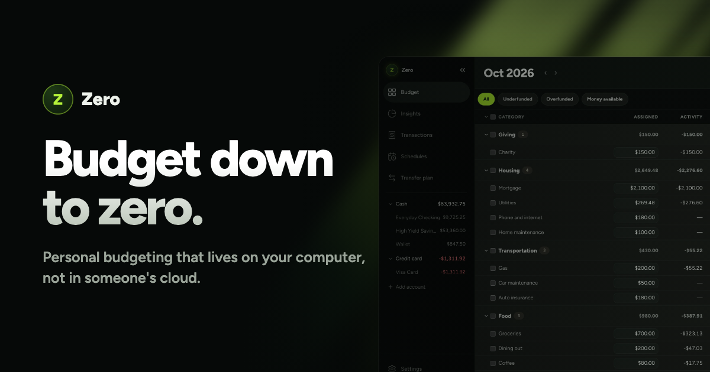

<a href="https://zero.jessedestroys.com"></a>

**Personal budgeting that lives on your computer, not in someone's cloud.** 100% free and open source.

[Website](https://zero.jessedestroys.com) · [Install](docs/INSTALL.md) · [Features](FEATURES.md) · [FAQ](https://zero.jessedestroys.com/faq)

Zero is envelope budgeting you run yourself. Your whole budget lives in one SQLite file: no account, no subscription, no bank connection, no telemetry. Copy that file and you've backed up everything.

### [▶ View the demo](https://zero.jessedestroys.com/#product)

## What's inside

- **Envelope budgeting** — put every dollar in a category and always know what your money is for.
- **Quick add** — a thumb-sized capture screen that installs on your phone.
- **Undo that works** — every change reverses exactly, from the toast or with ⌘Z.
- **Privacy mode** — hide every amount before you share your screen.
- **Auto-assign** — fund every underfunded category, or copy last month's budget, with a preview first.
- **Insights** — net worth across accounts and tracked assets, and where the money went.
- **CSV in, CSV out** — ten bank formats detected automatically, including YNAB register exports.
- **AI import** — hand a statement to Claude Code or Codex and the bundled `import-txns` skill adds only what's missing. It runs in your agent, never in Zero. [How it works](docs/AI-IMPORT.md).
- **Transfer plan** — your budget against real balances, as a checklist of transfers to make.

See it all at **[zero.jessedestroys.com](https://zero.jessedestroys.com)**.

## Quick start

```bash
git clone https://github.com/jessespencer/zero-budget.git
cd zero-budget
docker compose up -d --build
```

Then open `http://localhost:4040` in your browser, and a setup checklist walks you through your first accounts and categories.

No Docker, running on a Raspberry Pi, keeping it always on, backups and updates: see the **[install guide](docs/INSTALL.md)**.

> **Zero has no login, by design.** Keep it on your own machine or a private network, never on the open internet — see [SECURITY.md](SECURITY.md).

## Contributing

Bug fixes are welcome as pull requests; for features or anything that changes how money is calculated, open an issue first. [CONTRIBUTING.md](CONTRIBUTING.md) covers setup and conventions, and [SECURITY.md](SECURITY.md) how to report a vulnerability privately.

## License

[AGPL-3.0](LICENSE). Use it, change it and self-host it freely; if you run a modified version as a service for other people, share your source with them.

<picture>
  <source media="(prefers-color-scheme: dark)" srcset="docs/images/wordmark.webp">
  
</picture>
